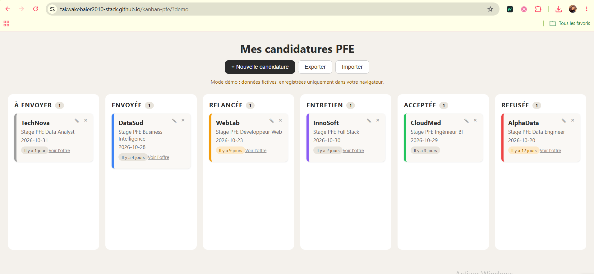
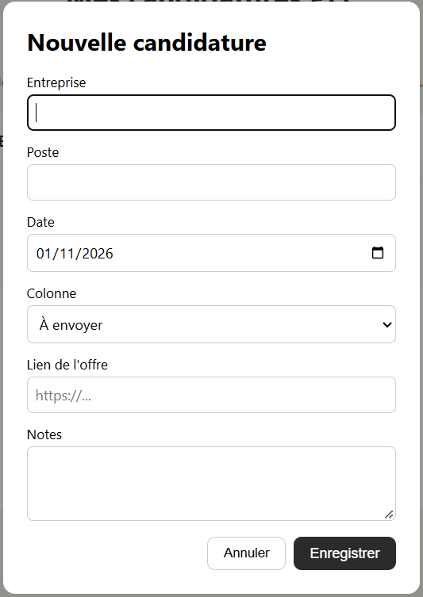

# Kanban PFE (version PHP / MySQL)
**[Utiliser l'application en ligne](https://mes-candidatures-pfe.site.je)** (inscription gratuite, tes candidatures sont enregistrées dans ton compte)

Application web pour suivre mes candidatures de stage PFE sous forme de tableau kanban. Cette version enregistre les données dans une **base MySQL**, via une **API PHP**.

> Une version 100 % JavaScript, sans serveur, est disponible sur la [branche `main`](https://github.com/takwakebaier2010-stack/kanban-pfe) avec une [démo en ligne](https://takwakebaier2010-stack.github.io/kanban-pfe/?demo).



## Fonctionnement

```
Navigateur (script.js)  →  api.php  →  MySQL (base kanban_pfe)
```

- `script.js` envoie des requêtes `fetch` à `api.php`.
- `api.php` vérifie les données et parle à MySQL avec PDO.
- La base garde les candidatures même si on ferme le navigateur.

## Fonctionnalités

- 6 colonnes : à envoyer, envoyée, relancée, entretien, acceptée, refusée
- Glisser-déposer des cartes (la date de dernière action est mise à jour)
- Ajout, modification et suppression d'une candidature
- Badge « il y a X jours » qui passe en orange après 7 jours
- Compteur de cartes par colonne
- Export de la liste au format JSON
- Comptes utilisateurs : inscription et connexion, chaque personne ne voit que ses propres candidatures


## Technologies

- HTML5, CSS3, JavaScript (fetch, async/await)
- PHP 8 avec PDO
- MySQL

## API

Toutes les routes sont sur `api.php`. Les données sont échangées en JSON.

| Méthode | Adresse | Action |
|---|---|---|
| GET | `api.php` | Liste des candidatures |
| POST | `api.php` | Ajoute une candidature |
| PUT | `api.php?id=3` | Modifie la candidature 3 |
| DELETE | `api.php?id=3` | Supprime la candidature 3 |

## Installation en local

Prérequis : WampServer ou XAMPP (PHP 8 et MySQL), et Git.

1. Cloner la branche :
   ```bash
   git clone --branch php-mysql https://github.com/takwakebaier2010-stack/kanban-pfe.git
   cd kanban-pfe
   ```
2. Démarrer MySQL (WampServer ou XAMPP).
3. Créer la base : ouvrir `http://localhost/phpmyadmin`, onglet **SQL**, coller le contenu de `database.sql`, puis **Exécuter**.
4. Créer le fichier de configuration à partir du modèle :
   ```bash
   copy config.example.php config.php
   ```
   Adapter `config.php` si besoin (par défaut : utilisateur `root`, mot de passe vide).
5. Lancer le serveur PHP intégré dans le dossier du projet :
   ```bash
   php -S localhost:8000
   ```
   Avec WampServer, utiliser le chemin complet de `php.exe`, par exemple `C:\wamp64\bin\php\php8.3.14\php.exe -S localhost:8000`.
6. Ouvrir `http://localhost:8000`.

## Mise en ligne

La version avec comptes est hébergée sur un hébergement PHP + MySQL gratuit.

1. Créer une base MySQL chez l'hébergeur, puis exécuter les deux `CREATE TABLE` de `database.sql` dans phpMyAdmin.
2. Créer un `config.php` avec les identifiants de l'hébergeur (jamais versionné).
3. Envoyer dans `htdocs` : `index.html`, `style.css`, `script.js`, `api.php`, `auth.php`, `commun.php`, `.htaccess` et `config.php`.
4. Ouvrir le site en HTTPS.

## Structure du projet

```
kanban-pfe/
├── index.html            structure de la page et formulaire
├── style.css             apparence
├── script.js             interface : cartes, déplacement, appels à l'API
├── api.php               API PHP (lecture, ajout, modification, suppression)
├── database.sql          création de la base et de la table
├── config.example.php    modèle de configuration (config.php est ignoré par Git)
└── screenshots/          captures d'écran
├── auth.php              inscription, connexion, déconnexion
├── commun.php            session, connexion MySQL, fonctions partagées
├── .htaccess             protège config.php et database.sql
```

## Sécurité

- Requêtes SQL **préparées** (PDO) : protection contre les injections SQL.
- Les données sont **validées côté serveur** (statut, date, longueurs, lien en `http` ou `https`).
- `config.php` n'est pas versionné.
- Comptes : mots de passe hachés (`password_hash`), sessions PHP avec cookie `HttpOnly`, `SameSite=Lax` et `Secure` en HTTPS.
- Chaque requête de l'API est filtrée par l'identifiant de l'utilisateur connecté : on ne peut pas lire ni modifier les candidatures d'un autre compte.
- Limites actuelles : pas de réinitialisation de mot de passe, pas de limitation des tentatives de connexion.

## Améliorations prévues

- [x] Comptes utilisateurs
- [ ] Réinitialisation du mot de passe
- [ ] Limitation des tentatives de connexion
- [ ] Suppression de son compte depuis l'application
- [ ] Recherche et filtres
- [ ] Rappels de relance

## Auteure

Takwa Kebaier, étudiante en 3e année de Licence Business Information Systems, ISG Tunis.
[www.linkedin.com/in/takwa-kebaier]
